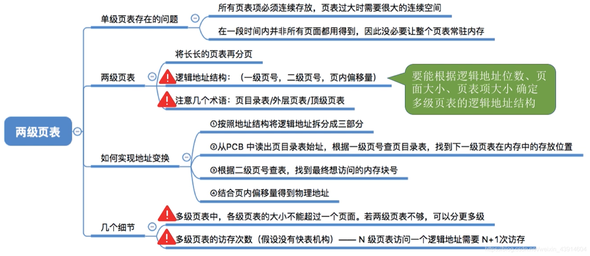
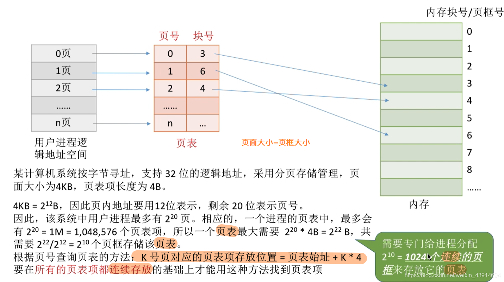
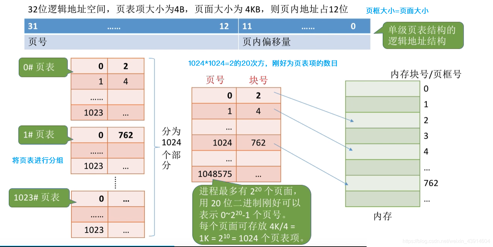
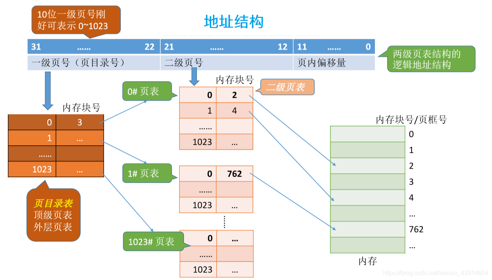
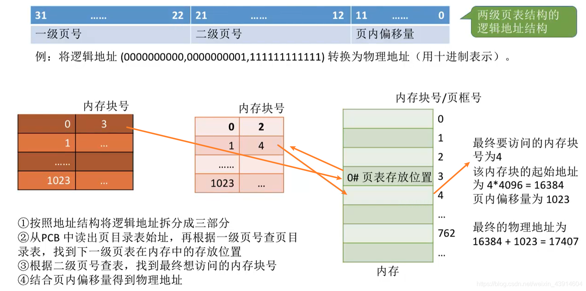
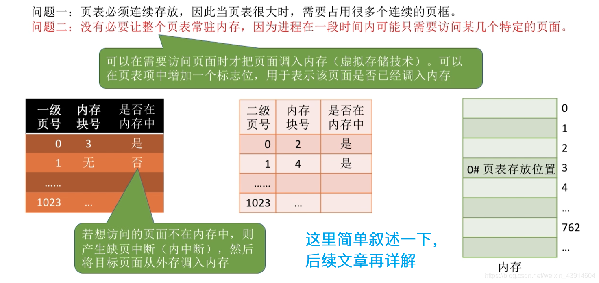
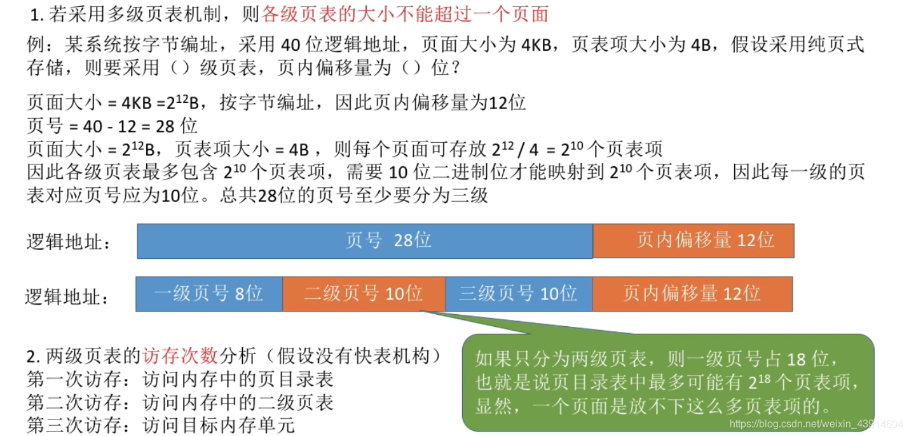

---

## 0.思维导图

## 1.为什么引入二级页表？

**因为单级页表存在一些问题，所以引入二级页表和多级页表，有两个问题：**

  
  
**上面提到了这两个问题，那么总结一下，并提出解决思想，引入二级页表的概念。**  

## 2.二级页表的原理和地址结构

- 对页表再次分组  
	
- 二级页表的地址结构及对应关系  
	

## 3.如何实现二级页表的地址变换？

  
**上面的部分我们解决了问题一，接下来是问题二，这里简单叙述一下，后面的文章会继续深入剖析。**  

## 4.几个小细节

  
参考：《王道操作系统》