## 0.思维导图

  

## 1.文件块、磁盘块

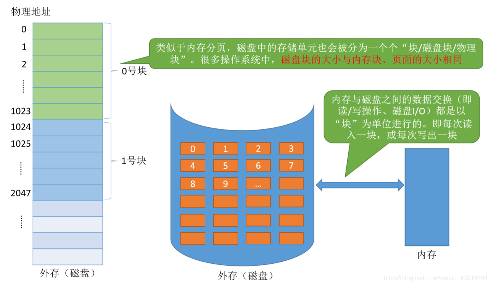  

## 2.连续分配

**连续分配优点：**  
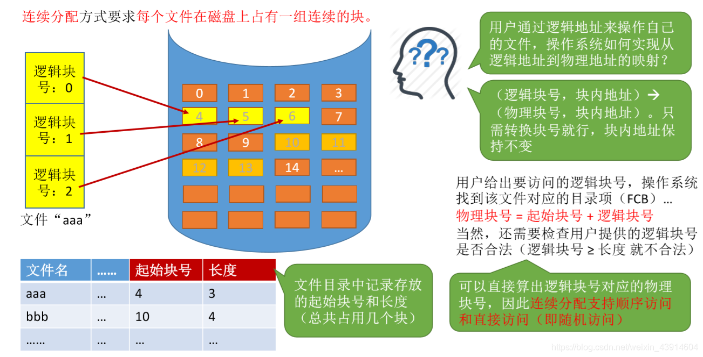  
  
**连续分配缺点：**

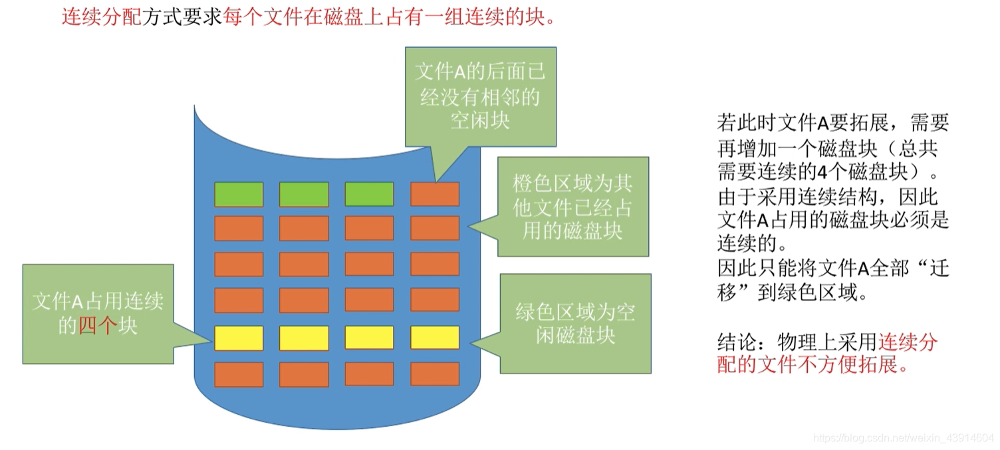  
  

## 3.链接分配

### 隐式链接

  

### 显式链接

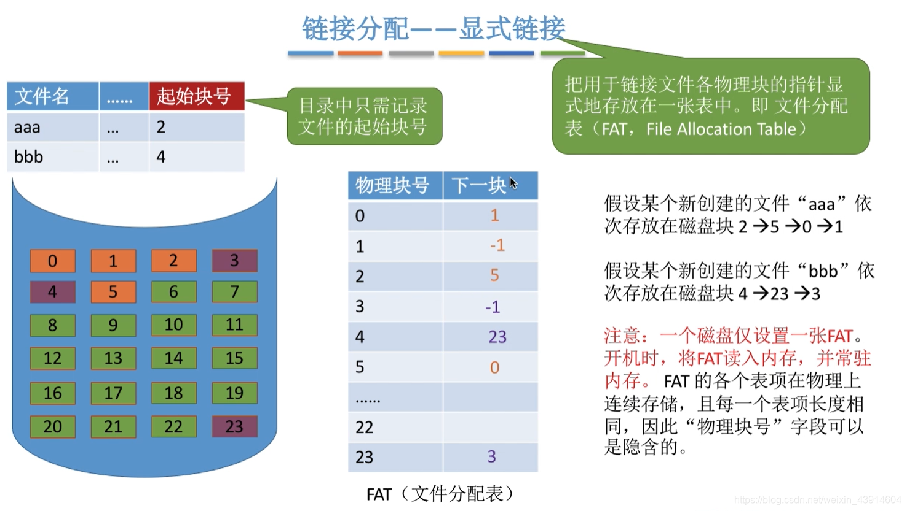  

### 链接分配总结

## 4.索引分配

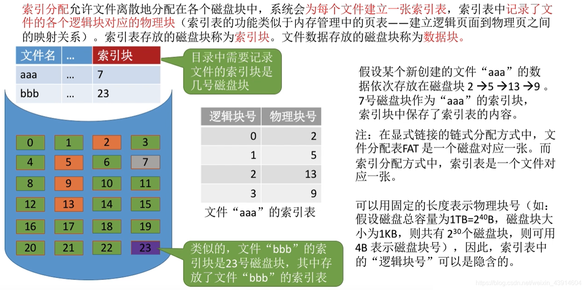  
**如何实现逻辑块号到物理块号的转换？**  
  
**数据太大，一个索引表装不下那么多的映射怎么办？**  
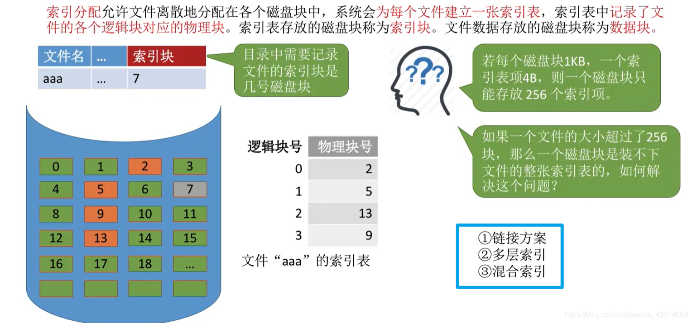

### 链接方案

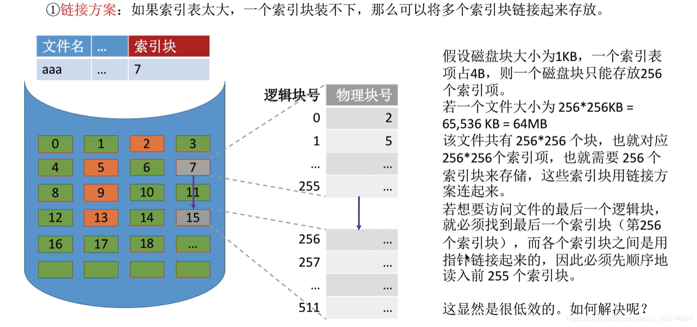

### 多层索引

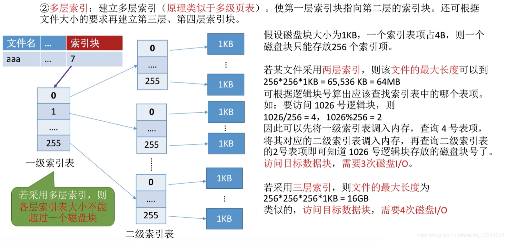  

### 混合索引

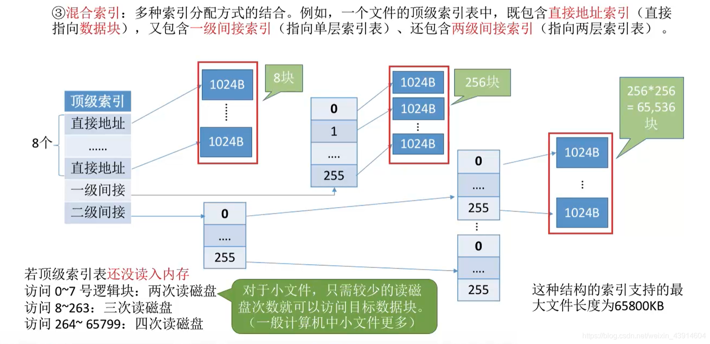

### 索引分配总结

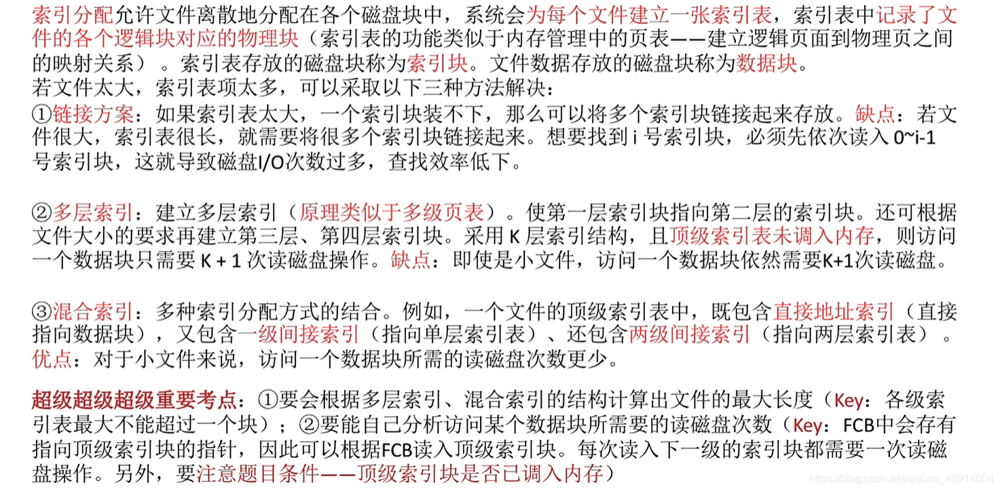

## 5.文件物理结构分配总结

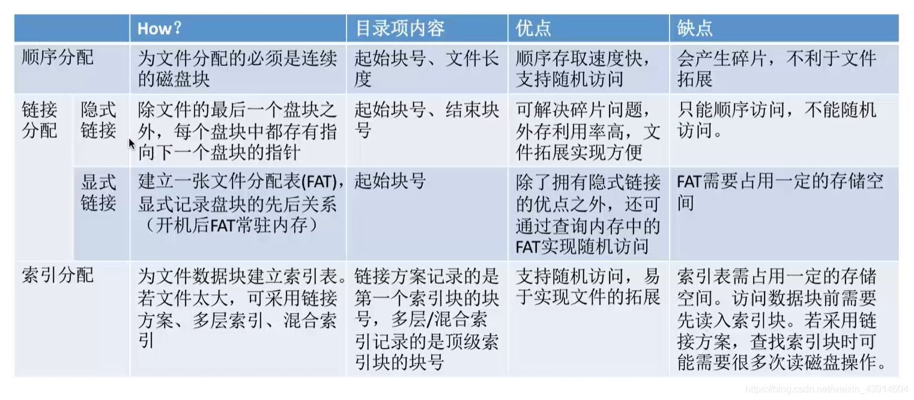

**参考：《王道操作系统》**