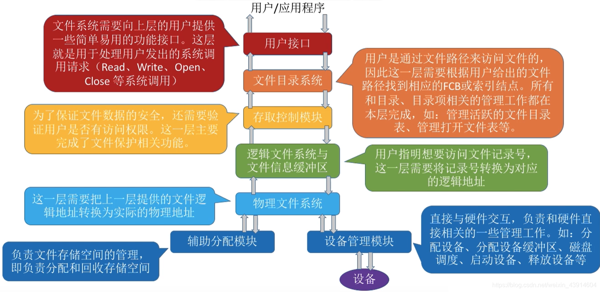
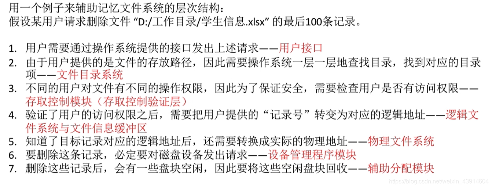

原创 于 2020-05-27 18:14:44 发布 · 7.9k 阅读

· 18

· 7 · 本内容遵循CC 4.0 BY-SA版权协议

版权声明：本文为博主原创文章，遵循 [CC 4.0 BY-SA](http://creativecommons.org/licenses/by-sa/4.0/) 版权协议，转载请附上原文出处链接和本声明。

收录于

操作系统

当前文章被收录于：

[

操作系统

](https://blog.csdn.net/weixin_43914604/category_9734257.html "操作系统")

*62* 篇文章 *1144* 人学习

对操作系统的主要知识点进行梳理和图文结合的总结

订阅专栏 [查看详情](https://blog.csdn.net/weixin_43914604/category_9734257.html)

博客涵盖操作系统文件系统层次结构相关知识，通过知识总览和举例的方式呈现，虽内容简略，但聚焦信息技术领域的操作系统与文件系统方面。

---

## 0.知识总览

## 1.举个例子

标签

[#操作系统](https://so.csdn.net/so/search/s.do?q=%E6%93%8D%E4%BD%9C%E7%B3%BB%E7%BB%9F&t=all&o=vip&s=&l=&f=&viparticle=&from_tracking_code=tag_word&from_code=app_blog_art) [#文件系统的层次结构](https://so.csdn.net/so/search/s.do?q=%E6%96%87%E4%BB%B6%E7%B3%BB%E7%BB%9F%E7%9A%84%E5%B1%82%E6%AC%A1%E7%BB%93%E6%9E%84&t=all&o=vip&s=&l=&f=&viparticle=&from_tracking_code=tag_word&from_code=app_blog_art)

- 18
	点赞
- 踩
- 7
	收藏
	觉得还不错? 一键收藏
- 0
	评论
- 分享
- 举报
	举报

专栏目录

<iframe src="https://kunpeng-sc.csdnimg.cn/?timestamp=1645783940/#/preview1/4492380?positionId=58&amp;adBlockFlag=0&amp;adId=1110446&amp;queryWord=4.1.9%20OS%E4%B9%8B%E6%96%87%E4%BB%B6%E7%B3%BB%E7%BB%9F%E7%9A%84%E5%B1%82%E6%AC%A1%E7%BB%93%E6%9E%84&amp;spm=1001.2101.3001.5002&amp;articleId=106387466" frameborder="0" width="100%" height="75px"></iframe>[高级 *OS* (十二） - 一个 *文件系统* 的设计与实现](https://blog.csdn.net/zxq997997/article/details/123412538)[zxq997997的博客](https://blog.csdn.net/zxq997997)

03-10 1523[高级 *OS* (十一） - 一个 *文件系统* 的设计与实现一、摘要二、引言三、概要设计四、详细设计 *4**.**1* 注册退出模块 *4**.*2 注册模块 *4**.*3 自定义 *文件系统* 类型模块 *4**.**4* 遍历 *文件系统* 模块 *4**.*5 kern\_mount函数模块 *4**.*6 创建文件夹模块 *4**.*7 创建文件模块 *4**.*8 myfs\_create\_by\_name()函数模块 *4**.**9* lookup\_one\_len()函数模块 *4**.**1* 0 \_\_lookup\_hash()函数模块 *4**.**1* *1* myfs\_mkdir()函数模块 *4**.**1* 2 myfs\_mknod()函数模块 *4**.**1* 3 myfs](https://blog.csdn.net/zxq997997/article/details/123412538)[*OS* 之存储管理---详解 *文件系统* 的实现方式(一)\_ *os* 文件管理系统](https://blog.csdn.net/lishanleilixin/article/details/89553890)8-9[系统调用open()首先搜索整个系统的打开文件表,如果打开,那么在单个进程的打开文件表中创建一个条目,并让其指向现有整个系统的打开文件表,如果这个文件尚未打开那么会根据给定的文件名来搜索目录结构。在找到文件后该文件的FCB会复制到内存的整个系统的开发文件表中,该表不但存储FCB,并且还跟踪打开该文件的进程的数量。接下来在](https://blog.csdn.net/lishanleilixin/article/details/89553890)[【 *OS* 】 *操作系统* 文件管理知识点](https://blog.csdn.net/qq_40205510/article/details/158924416)8-26[文件的属性通常包括:文件名、标识符(系统内部使用)、类型、位置(路径)、大小、创建/修改时间、所有者信息以及保护信息。 二、 文件的逻辑结构与物理结构 文件的结构可分为逻辑结构和物理结构,这是理解文件如何组织与存储的基础。 *1**.* 文件的逻辑结构(用户视角) 指用户所看到的文件组织形式,与物理存储设备无关。 无*.**.**.*](https://blog.csdn.net/qq_40205510/article/details/158924416)[常见的 *文件系统* 格式](https://blog.csdn.net/weixin_42241611/article/details/126746651)[weixin\_42241611的博客](https://blog.csdn.net/weixin_42241611)

09-07 5209[FAT(File Allocation Table) *文件系统* 诞生于 *1* *9* 77年，它最初是为软盘设计的 *文件系统* ，但是后来随着微软推出d *os* 和win *9* x系统，FAT *文件系统* 经过适配被逐渐用到了硬盘上，并且在那时的20年中，一直是主流的 *文件系统* 。ExFAT是虽然也是微软开发的 *文件系统* ，但说它是windows下的 *文件系统* 并不合适，它是专门为闪存盘设计的 *文件系统* ，单个文件突破了 *4* G的限制，而且分区的最大容量可达6 *4* ZB（比EB大一级的），建议5 *1* 2TB。 *文件系统* 可以被使用在磁带，移动硬盘，闪存等地方。](https://blog.csdn.net/weixin_42241611/article/details/126746651)[DRBD *9**.*26 Anolis *os* 8*.**9* 安装配置](https://blog.csdn.net/m0_51902127/article/details/141161020)[m0\_51902127的博客](https://blog.csdn.net/m0_51902127)

08-13 1986[安装完DRBD后systemctl status drbd，发现服务没有启动，使用systemctl startdrbd启动后，检查drbd服务状态，发现没有相应的drbd内核模块。利用键盘方向键进行选择，driver里找到DRBD配置选项，选中成\*号，然后保存配置为*.*config文件，文件名不要改动。#-j *4* 后面的 *4* 是CPU的核数，根据自己的CPU核数填写，查询核数可以使用命令cat /proc/cpuinfo 查看CPU核数信息，核数越多编译速度越快。在编译之前，首先需要执行清理命令。](https://blog.csdn.net/m0_51902127/article/details/141161020)[*操作系统* 概览](https://blog.csdn.net/Cheatscat/article/details/78226398)9-6[综上所述,*操作系统* (Operating System, *OS*)是指控制和管理整个计算机系统的硬件和软件资源,并合理地组织调度计算机的工作和资源的分配,以提供给用户和其他软件方便的接口和环境的程序集合。计算机 *操作系统* 是随着计算机研究和应用的发展逐步形成并发展起来的,它是计算机系统中最基本的系统软件。](https://blog.csdn.net/Cheatscat/article/details/78226398)[计算机 *操作系统* ——第八章 文件管理\_两级索引顺序文件](https://blog.csdn.net/rc4gyyc/article/details/144563013)8-17[*文件系统* 是 *OS* 的一部分,它提供了一种管理机制,以便 *OS* 对自身及所有用户的数据与程序进行在线存储和访问。 *文件系统* 由两部分组成:文件集合和目录。 *文件系统* 的管理功能是通过将其管理的程序和数据组织成一系列文件的方式实现的,而文件则是指具有文件名的若干相关元素的集合。元素通常是记录,而记录又是一组有意义的数据项的*.**.**.*](https://blog.csdn.net/rc4gyyc/article/details/144563013)[H3C-V7防火墙配置SSL VPN IP资源典型案例(华三）](https://blog.csdn.net/m0_68265458/article/details/137679758)[m0\_68265458的博客](https://blog.csdn.net/m0_68265458)

04-12 5096[H3C-V7防火墙配置SSL VPN IP资源典型案例(华三）](https://blog.csdn.net/m0_68265458/article/details/137679758)[【 *操作系统* 】文件管理（七）—— *文件系统* 的 *层次结构* 与基本操作](https://devpress.csdn.net/v1/article/detail/126813407)[haoweixl的博客](https://blog.csdn.net/weixin_43848614)

09-12 7021[假设某用户请求删除文件 “D:/工作目录/学生信息*.*xlsx” 的最后 *1* 00条记录。进行 Create 系统调用时，需要提供的几个主要参数： *操作系统* 在处理 Create 系统调用时，主要做了两件事：进行 Delete 系统调用时，需要提供的几个主要参数： *操作系统* 在处理 Delete 系统调用时，主要做了几件事：在很多 *操作系统* 中，在对文件进行操作之前，要求用户先使用 open 系统调用“打开文件”，需要提供的几个主要参数： *操作系统* 在处理 open 系统调用时，主要做了几件事：读文件：将文件数据读入内存，](https://devpress.csdn.net/v1/article/detail/126813407)[【 *OS* 笔记33】:*文件系统* - 文件目录的结构\_二级目录](https://blog.csdn.net/lyh2004_08/article/details/156603689)8-22[*1**.* 一级目录结构 Single-Level Directory 这是最早期、最简单的结构。 定义:*文件系统* 中的*.**.**.*](https://blog.csdn.net/lyh2004_08/article/details/156603689)[*操作系统* （ *1* *4* ）---- *文件系统* 的结构](https://blog.csdn.net/weixin_69884785/article/details/136100257)[weixin\_69884785的博客](https://blog.csdn.net/weixin_69884785)

02-12 3709[*文件系统* 的结构： *文件系统* 的 *层次结构* ， *文件系统* 的全局结构， *文件系统* 的虚拟结构， *文件系统* 的挂载点](https://blog.csdn.net/weixin_69884785/article/details/136100257)[Android *OS* 体系结构介绍及需要撑握开发库](https://blog.csdn.net/chenlove1/article/details/43052457)[陈英有](https://blog.csdn.net/chenlove1)

01-23 4454[*OS* 体系结构介绍： 第一、 *操作系统* 层（ *OS* ） 第二、各种库（Libraries）和Android 运行环境（RunTime） 第三、应用程序框架（Application Framework） 第四、应用程序（Application） 以下分别介绍Andoid各个层次的软件的重点及其相关技术： ● *操作系统* 层（ *OS* ） Android使用Linux2*.*6作](https://blog.csdn.net/chenlove1/article/details/43052457)[50 *文件系统* 的 *层次结构*](https://blog.csdn.net/weixin_41883890/article/details/117014396)[weixin\_41883890的博客](https://blog.csdn.net/weixin_41883890)

05-19 1158[*文件系统* *层次结构* ：现代 *操作系统* 有多种 *文件系统* 类型（如FAT32、NTFS、ext2等），因此 *文件系统* 的 *层次结构* 也不尽相同。如下为较合理的 *层次结构* *1* 、 用户调用接口 2、文件目录系统](https://blog.csdn.net/weixin_41883890/article/details/117014396)[*OS* \_I/O系统的 *层次结构*](https://cxxu1375.blog.csdn.net/article/details/125131314)[xuchaoxin1375的博客](https://blog.csdn.net/xuchaoxin1375)

06-05 5305[用户层软件设备独立性(无关性)软件设备驱动程序中断处理程序设备控制器它是I/O系统与上层系统之间的接口，向上层提供对设备进行操作的抽象I/O命令，以方便高层对设备的使用。有不少 *OS* 在用户层提供了与I/O操作有关的库函数，供用户使用。在上层系统中有 *文件系统* 、虚拟存储器系统以及用户进程等。包括:块设备接口流设备接口网络通信接口该接口是软件/硬件接口，在它的上面是中断处理程序和用于不同设备的设备驱动程序。在它的下面是各种设备的控制器。如CD-ROM控制器、硬盘控制器、键盘控制器、打印机控制器、网络控制器等，它们都](https://cxxu1375.blog.csdn.net/article/details/125131314)[理解Linux *文件系统* *层次结构*](https://it1995.blog.csdn.net/article/details/148681705)[IT1995的博客](https://blog.csdn.net/qq78442761)

06-16 1346[Linux *文件系统* 采用单根结构(/)设计，遵循FHS标准。主要目录包括：/bin存放基础命令、/sbin存放系统管理工具、/etc存储配置文件、/home存放用户数据。系统运行时数据存放在/var，临时文件在/tmp，第三方软件在/opt。硬件驱动位于/dev，内核和进程信息在/proc和/sys。理解这种 *层次结构* 有助于系统维护、故障排查和安全防护，是Linux用户必备的基础知识。](https://it1995.blog.csdn.net/article/details/148681705)[Ext *4* *文件系统* 修复](https://blog.csdn.net/weixin_30240349/article/details/101578804)[weixin\_30240349的博客](https://blog.csdn.net/weixin_30240349)

08-02 4310[Ext *4* *文件系统* 修复 目录 一、 super block*.**.**.**.**.**.**.**.**.**.**.**.**.**.**.**.**.**.**.**.**.**.**.**.**.**.**.**.**.**.**.**.**.**.**.**.**.**.**.**.**.**.**.**.**.**.**.**.**.**.**.**.**.**.**.**.**.**.**.**.**.**.**.**.**.**.**.**.**.**.**.**.**.**.**.**.**.**.**.**.**.**.**.**.**.**.**.**.**.**.**.**.**.**.**.**.**.**.**.**.**.**.**.**.**.**.**.**.**.**.**.**.**.**.**.**.**.**.**.**.**.**.**.**.**.**.**.**.**.**.**.**.**.**.**.**.**.**.**.**.**.**.**.**.**.* 二、查看分区设备信息*.**.**.**.**.*](https://blog.csdn.net/weixin_30240349/article/details/101578804)[Linux *文件系统* 的 *层次结构* 、每个目录的含义、文件属性以及文件中第一列的第一个字符的含义](https://blog.csdn.net/qq_59020256/article/details/135543308)[qq\_59020256的博客](https://blog.csdn.net/qq_59020256)

01-12 1199[这个目录是Redhat/Cent *OS* 所特有的目录，Selinux是一个安全机制，类似于windows的防火墙，但是这套机制比较复杂，这个目录就是存放selinux相关的文件的。这个目录是一个虚拟的目录，他是系统内存的映射，我们可以通过直接访问这个目录来获取系统信息，这个目录的内容不在硬盘上而是载内存里面。dev是Device的缩写，该目录下存放的是Linux的外部设备，在Linux中访问设备的方式和访问文件的方式是相同的。这个目录中存放着在不断扩充着的东西，我们习惯将那些经常被修改的目录放在这个目录下。](https://blog.csdn.net/qq_59020256/article/details/135543308)[Python *文件系统* 管理中 *1* 2个 *os* 模块应用窍门！](https://blog.csdn.net/zhang120529/article/details/142615238)[zhang120529的博客](https://blog.csdn.net/zhang120529)

09-28 1440[本文将介绍如何使用 *os* 模块中的关键函数，包括获取、更改当前工作目录、列出目录内容、创建与删除目录、重命名文件或目录以及检查文件或目录的存在性等！](https://blog.csdn.net/zhang120529/article/details/142615238)[linux *文件系统* *层次结构* 第一篇](https://blog.csdn.net/qq_54013154/article/details/129208330)[qq\_54013154的博客](https://blog.csdn.net/qq_54013154)

02-24 318[*文件系统* *层次结构*](https://blog.csdn.net/qq_54013154/article/details/129208330)[Python标准库之 *os*](https://blog.csdn.net/m0_46223009/article/details/128065092)

[

热门推荐

](https://blog.csdn.net/m0_46223009/article/details/128065092)

[AlbertDarren的博客](https://blog.csdn.net/m0_46223009)

11-27 3万+[顾名思义， *OS* 表示Operating System，即 *操作系统* 。 *OS* 标准库是一个 *操作系统* 接口模块，提供一些方便使用 *操作系统* 相关功能的函数，具体安装位置可通过导入 *os* 模块查看属性得到。当需要在Python代码中调用 *OS* 相关功能实现业务逻辑或者无法直接使用命令行工具时，我们就需要考虑导入此模块，因此有必要进行深入学习。](https://blog.csdn.net/m0_46223009/article/details/128065092)[maciNT *os* h双启动配置教程：Windows NT与Mac *OS* *9* 共存的实用技巧](https://blog.csdn.net/gitblog_00612/article/details/151701138)

[

最新发布

](https://blog.csdn.net/gitblog_00612/article/details/151701138)

[gitblog\_00612的博客](https://blog.csdn.net/gitblog_00612)

08-05 878[在Power Macint *os* h系统上实现Windows NT与Mac *OS* *9* 双启动是一项极具价值的技术实践。maciNT *os* h项目作为PowerPC架构的Windows NT移植方案，为经典苹果电脑用户提供了体验两种 *操作系统* 的可能性。本文将详细介绍如何在支持的Power Macint *os* h机型上配置双启动环境，让你轻松实现Windows NT与Mac *OS* *9* 的无缝切换。 ## 支持的Pow](https://blog.csdn.net/gitblog_00612/article/details/151701138)[HUST *OS* *9**.*0 *文件系统* 【自学笔记】](https://blog.csdn.net/Irish_Moonshine/article/details/91127206)[Irish\_Moonshine的博客](https://blog.csdn.net/Irish_Moonshine)

06-07 335[*9**.*0 *文件系统* *9**.**1* *文件系统* 概念 *9**.*2文件物理结构 *9**.*3FAT *文件系统* *9**.**4* 文件存储和目录 *9**.**1* *文件系统* 概念 文件由若干信息项有序构成 信息项可以使字节,可以是结构化数据 分类标准 *1*:文件的用途 系统文件 库文件 用户文件 ~2:文件的操作权限 只读文件 读写文件 不保护文件 ~3:文件的性质 普通文件 目录文件 设备文件 \*目录文件: 记录目录里面文件列表信息 文件名,文件存放地址,文*.**.**.*](https://blog.csdn.net/Irish_Moonshine/article/details/91127206)[Linux *4**.**9* 内核 *文件系统* 核心机制](https://blog.csdn.net/weixin_43389934/article/details/145808678)[程序喵的博客](https://blog.csdn.net/weixin_43389934)

02-23 271[linux内核 *文件系统* 核心机制](https://blog.csdn.net/weixin_43389934/article/details/145808678)[linux ext *4* *文件系统* mk,让Cent *OS* 支持ext *4* *文件系统*](https://blog.csdn.net/weixin_34123811/article/details/116678532)[weixin\_34123811的博客](https://blog.csdn.net/weixin_34123811)

05-01 982[需要将一块硬盘格式化成ext *4* *文件系统* ，结果报错了：# mkfs*.*ext *4* /dev/xvdb-bash: mkfs*.*ext *4*: command not found上网查了下，发现Cent *OS* 默认是支持ext *4* *文件系统* 的，不过需要用户自己动手配置一下。于是就动手开始配置了(内核版本：2*.*6*.**1* 8-308*.*el5xen)。Cent *OS* 5*.*x里面是有ext *4* 模块的，只是没加载，所以我们先把模块加入系*.**.**.*](https://blog.csdn.net/weixin_34123811/article/details/116678532)[RocketMq面板访问异常 com*.*alibaba*.*fastjson*.*JSONException: not cl *os* e json text, token: string](https://blog.csdn.net/qq_21067307/article/details/126037615)[qq\_21067307的博客](https://blog.csdn.net/qq_21067307)

07-28 5544[rocketmq JSONException: not cl *os* e json text, token: string 问题解决](https://blog.csdn.net/qq_21067307/article/details/126037615)[ComfyUI/Wan2*.*2 SmoothMix 自动扩写文生视频](https://download.csdn.net/download/qq_20288327/92425913)[文件编号：c0 *1* 8 *4* ComfyUI使用教程、开发指导、资源下载：https://datayang*.*blog*.*csdn*.*net/article/details/ *1* *4* 522052 *4* AIGC工具平台Tauri+Django开源ComfyUI项目介绍和使用https://datayang*.*blog*.*csdn*.*net/article/details/ *1* *4* 63 *1* 6250更多工具介绍项目源码搭建介绍：《我的AI工具箱Tauri+Django开源git项目介绍和使用》https://datayang*.*blog*.*csdn*.*net/article/details/ *1* *4* 6 *1* 568 *1* 7图形桌面工具使用教程：《我的AI工具箱Tauri+Django环境开发，支持局域网使用》https://datayang*.*blog*.*csdn*.*net/article/details/ *1* *4* *1* 8 *9* 770 *4*](https://download.csdn.net/download/qq_20288327/92425913)- [关于我们](https://www.csdn.net/company/index.html#about)
- [招贤纳士](https://www.csdn.net/company/index.html#recruit)
- [商务合作](https://fsc-p05.txscrm.com/T8PN8SFII7W)
- [寻求报道](https://marketing.csdn.net/questions/Q2202181748074189855)
- [协议专区](https://marketing.csdn.net/p/a65bad49d09e5e6d1a9c674bb41ef331?pId=3340)
- 400-660-0108
- [kefu@csdn.net](mailto:webmaster@csdn.net)
- [在线客服](https://csdn.s2.udesk.cn/im_client/?web_plugin_id=29181)
- 工作时间 8:30-22:00
- [公安备案号11010502030143](http://www.beian.gov.cn/portal/registerSystemInfo?recordcode=11010502030143)
- [京ICP备19004658号](http://beian.miit.gov.cn/publish/query/indexFirst.action)
- [京网文〔2020〕1039-165号](https://csdnimg.cn/release/live_fe/culture_license.png)
- [经营性网站备案信息](https://csdnimg.cn/cdn/content-toolbar/csdn-ICP.png)
- [北京互联网违法和不良信息举报中心](http://www.bjjubao.org/)
- [家长监护](https://download.csdn.net/tutelage/home)
- [网络110报警服务](https://cyberpolice.mps.gov.cn/)
- [中国互联网举报中心](http://www.12377.cn/)
- [Chrome商店下载](https://chrome.google.com/webstore/detail/csdn%E5%BC%80%E5%8F%91%E8%80%85%E5%8A%A9%E6%89%8B/kfkdboecolemdjodhmhmcibjocfopejo?hl=zh-CN)
- [账号管理规范](https://blog.csdn.net/blogdevteam/article/details/126135357)
- [版权与免责声明](https://www.csdn.net/company/index.html#statement)
- [版权申诉](https://blog.csdn.net/blogdevteam/article/details/90369522)
- [出版物许可证](https://img-home.csdnimg.cn/images/20250103023206.png)
- [营业执照](https://img-home.csdnimg.cn/images/20250103023201.png)
- ©1999-2026北京创新乐知网络技术有限公司