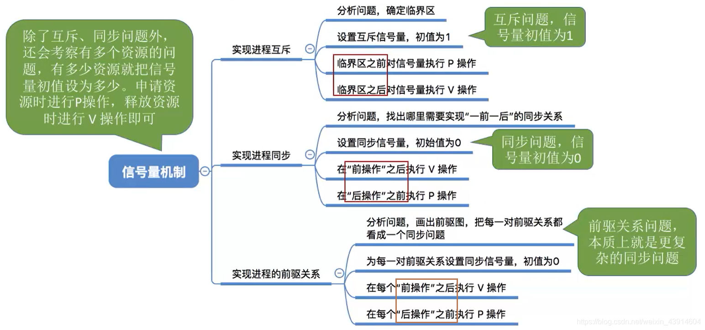
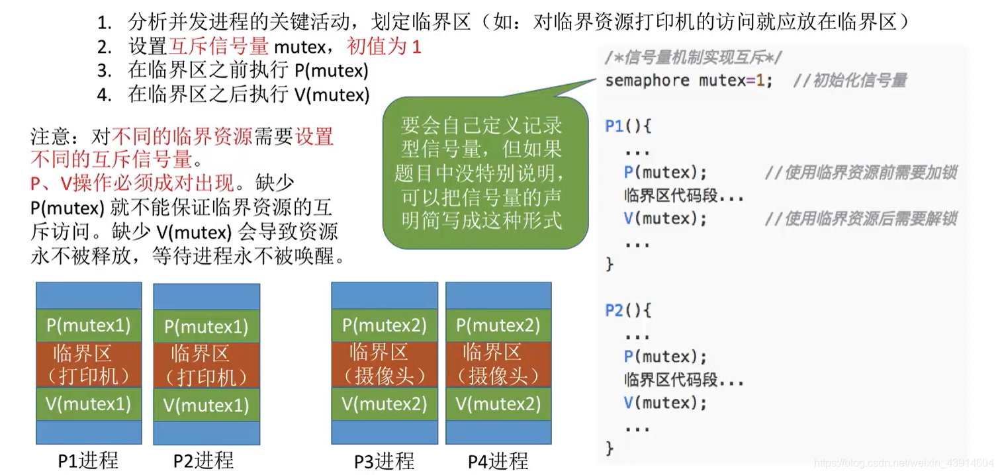
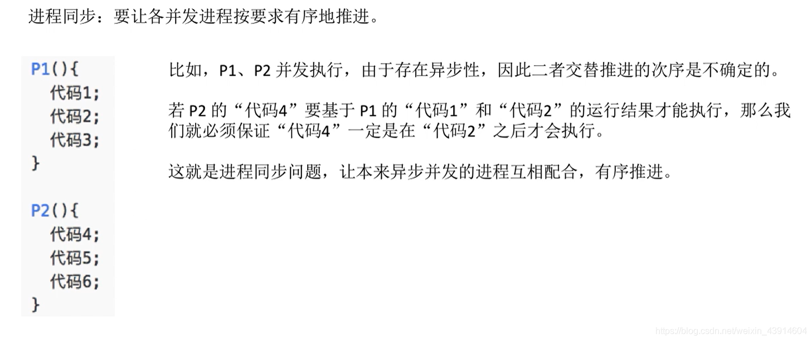
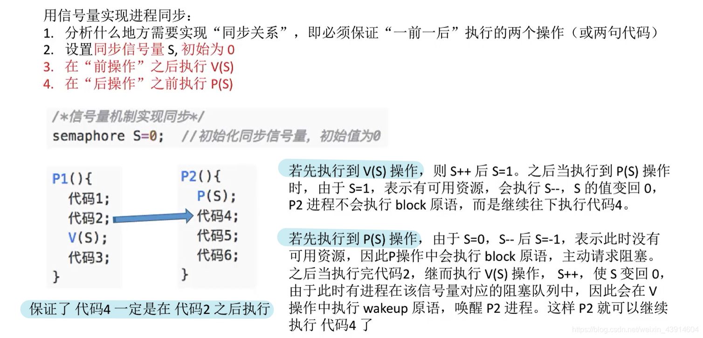
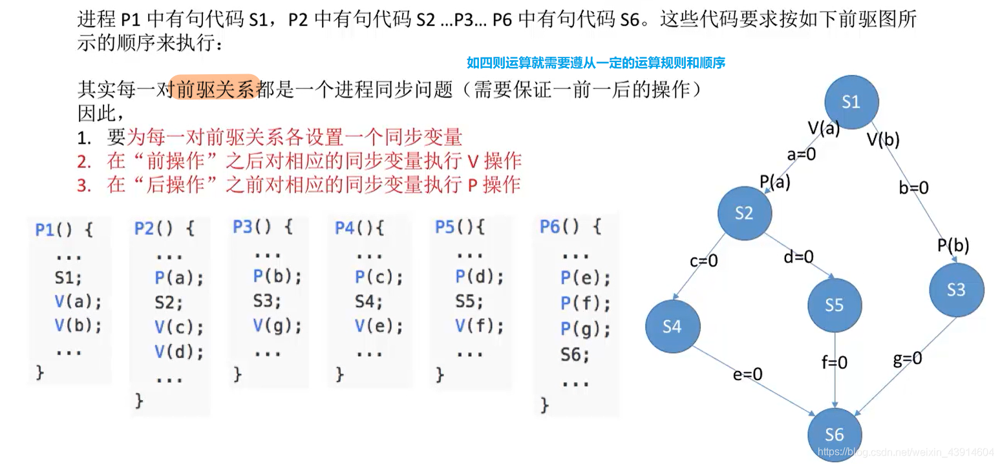

---

##### 0.思维导图

- 在看此小结内容之前，需熟悉这一篇博客里面的知识，关于P、V操作内部实现原理等 [https://blog.csdn.net/weixin\_43914604/article/details/104951182](https://blog.csdn.net/weixin_43914604/article/details/104951182)  
	

##### 1.信号量机制实现进程互斥

##### 2.信号量机制实现进程同步

- 想象一下四则运算的顺序，加减乘除；  
	
- 要想理解这一部分知识，必须知道P、V操作的内部实现原理  
	

##### 3.信号量机制实现前驱关系

参考： [https://www.bilibili.com/video/av70156862?p=21](https://www.bilibili.com/video/av70156862?p=21)