### 0.思维导图

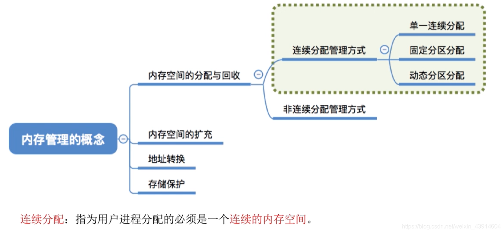  

### 1.单一连续分配

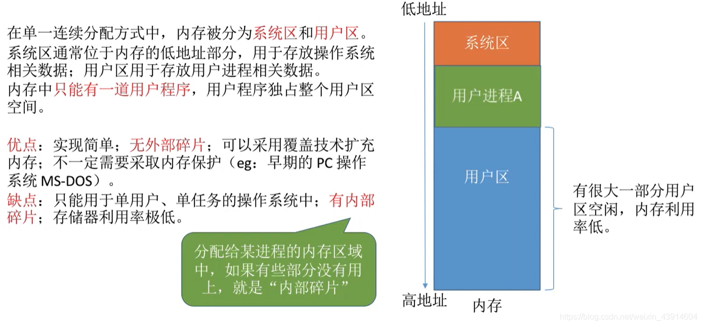

### 2.固定分区分配

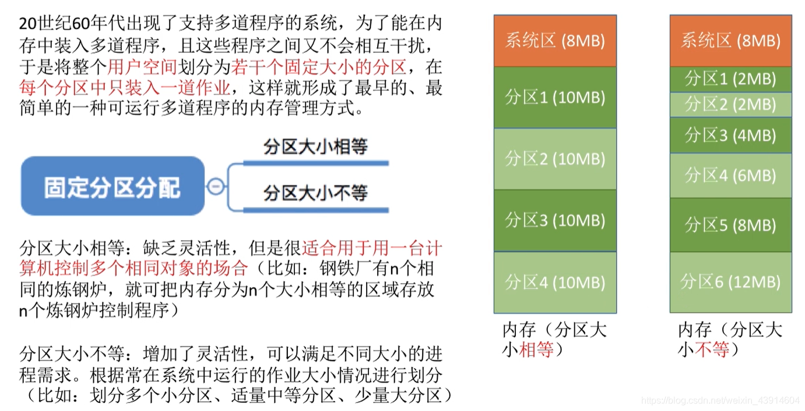

#### （1）分区说明表

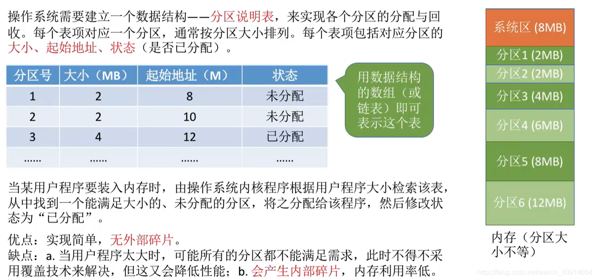

### 3.动态分区分配（可变分区分配）

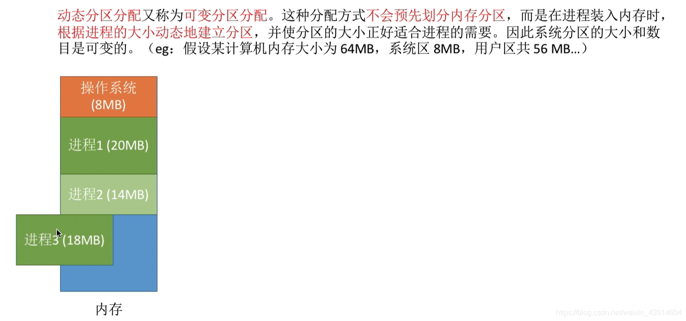  
  
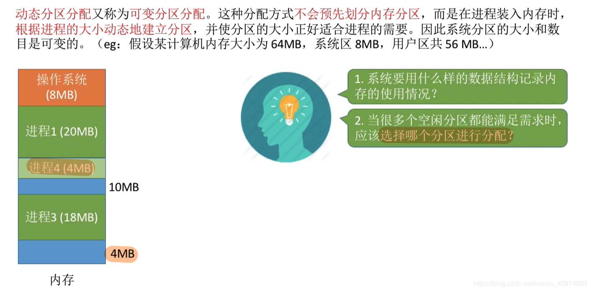  

#### （1）系统要用怎样的数据结构记录内存的使用情况呢？

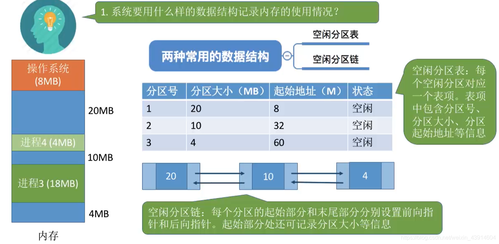

#### （2）当多个空闲分区都能满足要求时，应该选择哪个分区进行分配？

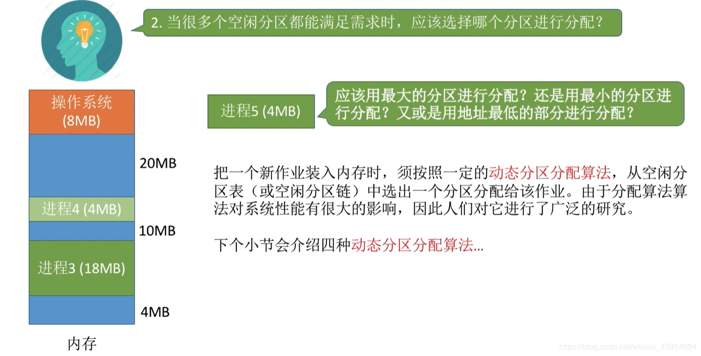

#### （3）如何进行分区的分配和回收操作？

**如何分配？**  
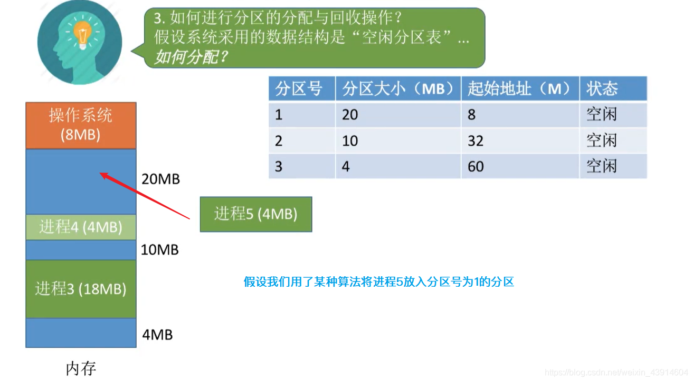  
  
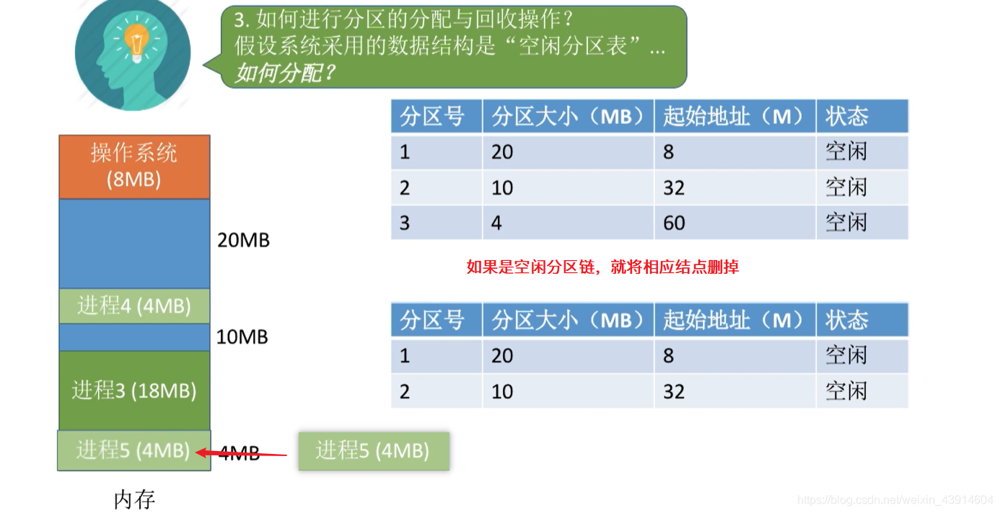  
**如何回收？**  
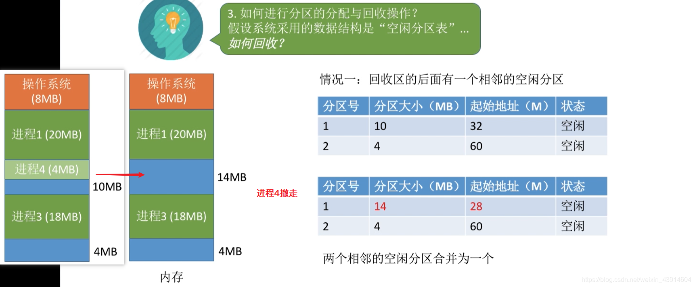  
  
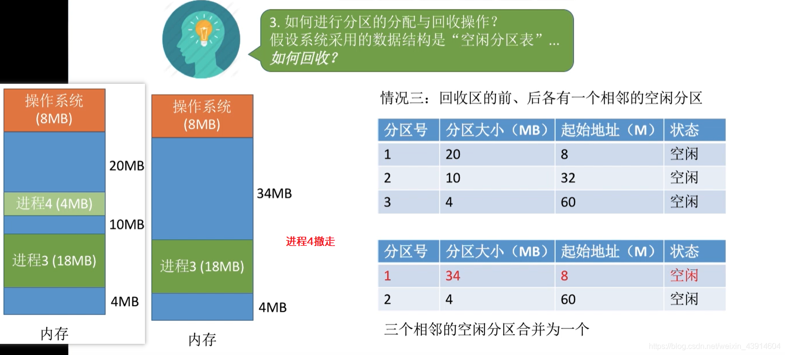  

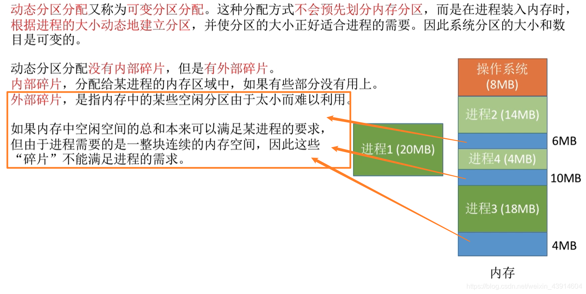