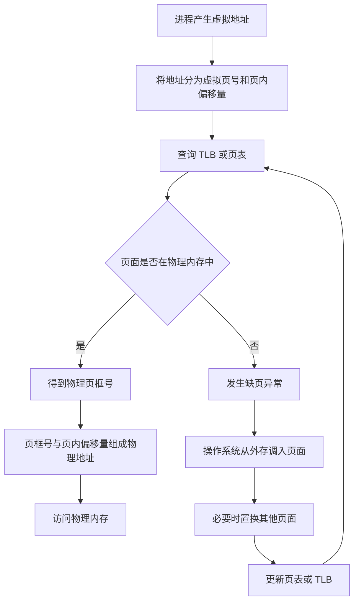

# 空分复用技术详解

> [!abstract] 一句话理解
> **空分复用技术**是从空间上划分、分配或映射一个物理资源，使其不同空间区域能够分别供多个程序或用户使用，从而把一个物理实体表现为多个逻辑上的对应物。

相关知识：[[1.1.2 操作系统的特征]]

## 1. “空分复用”是什么意思

“空分复用”可以拆成三个部分理解：

- **空**：空间，即资源所占据的空间，不是单纯指“空闲”。
- **分**：对资源空间进行划分、分配或地址映射。
- **复用**：多个程序或用户共同使用同一个物理资源。

因此，空分复用的核心是：

> **一个物理资源，在空间上被组织成多个相对独立的逻辑部分。**

例如，一块物理磁盘可以被划分为 C 盘、D 盘和 E 盘。用户看到的是多个逻辑磁盘，但底层实际可能只有一块物理磁盘。

可以把它类比为一栋宿舍楼：

- 整栋楼是一个物理实体；
- 不同房间是不同的空间区域；
- 多名学生可以分别使用不同房间；
- 每名学生都拥有一个相对独立的逻辑空间。

这就是按照空间对一个物理资源进行复用。

## 2. 空分复用与时分复用

操作系统中的虚拟技术通常可以分为两类：**时分复用技术**和**空分复用技术**。

| 对比项 | 时分复用技术 | 空分复用技术 |
| --- | --- | --- |
| 划分维度 | 时间 | 空间 |
| 基本方式 | 多个任务轮流使用同一物理资源 | 多个任务分别使用资源的不同空间区域 |
| 典型资源 | CPU | 内存、磁盘 |
| 典型应用 | 虚拟处理器 | 虚拟存储器、虚拟磁盘 |
| 用户感受 | 每个进程仿佛都拥有一个 CPU | 每个进程仿佛都拥有独立的存储空间 |
| 实际情况 | CPU 按时间片轮流为多个进程服务 | 物理存储空间被划分、分配和映射给多个对象 |

> [!tip] 记忆口诀
> **CPU 主要按时间轮流使用——时分复用；存储器主要按空间划分使用——空分复用。**

### 2.1 时分复用示意

假设只有一个 CPU，进程 A、B、C 轮流使用它：

```text
时间 ──────────────────────────────────────>
CPU   │ A │ B │ C │ A │ B │ C │ A │ ……
```

任意一个时刻，CPU 通常只执行其中一个进程；但切换速度很快，宏观上看，多个进程似乎都在同时运行。

### 2.2 空分复用示意

假设物理内存被划分为若干区域：

```text
物理内存
┌──────────────┐
│ 操作系统     │
├──────────────┤
│ 进程 A 的页面│
├──────────────┤
│ 进程 B 的页面│
├──────────────┤
│ 进程 C 的页面│
├──────────────┤
│ 空闲区域     │
└──────────────┘
```

进程 A、B、C 的内容可以同时存在于物理内存的不同空间区域中，这体现了空分复用思想。

## 3. 为什么虚拟存储器属于空分复用

虚拟存储器是空分复用技术最典型的应用。

### 3.1 虚拟页与物理页框

在分页存储管理中：

- 进程的虚拟地址空间被划分成大小相等的**页**；
- 物理内存被划分成大小相等的**页框**；
- 操作系统通过页表，将虚拟页映射到物理页框；
- 不同进程可以使用物理内存中的不同页框；
- 同一进程的页面不必连续存放在物理内存中。

例如，进程 A 的虚拟页面可能按照下面的方式进行映射：

| 进程 A 的虚拟页 | 对应位置 |
| --- | --- |
| 第 0 页 | 物理页框 1 |
| 第 1 页 | 暂时位于外存 |
| 第 2 页 | 物理页框 6 |
| 第 3 页 | 物理页框 3 |

从进程 A 的角度看，自己的虚拟页是连续编号的；但在物理内存中，这些页面可以离散地分布在页框 1、6、3 等位置。

这种把虚拟空间映射到不同物理空间区域的机制，就是空分复用思想的体现。

### 3.2 地址转换

CPU 发出的通常是虚拟地址。虚拟地址经过地址转换后，才能得到真正访问物理内存所需的物理地址。



虚拟地址通常可以表示为：

```text
虚拟地址 = 虚拟页号 + 页内偏移量
```

页表负责把虚拟页号转换为物理页框号：

```text
虚拟页号 ──查询页表──> 物理页框号
```

页内偏移量在转换前后通常保持不变，因此：

```text
物理地址 = 物理页框号 + 页内偏移量
```

### 3.3 页面不在内存中时

如果进程访问的页面当前不在物理内存中，会发生**缺页异常**，也常称为缺页中断。处理过程如下：

1. 进程访问某个虚拟地址。
2. CPU 查询页表，发现该页面不在物理内存中。
3. CPU 产生缺页异常，转入操作系统处理。
4. 操作系统找到一个空闲页框。
5. 操作系统把所需页面从外存调入该页框。
6. 如果没有空闲页框，则通过页面置换算法选择一个页面换出。
7. 操作系统更新页表和相关状态信息。
8. 重新执行刚才因缺页而未完成的指令。

虽然请求调页包含“先换出、后换入”的时间过程，但从虚拟技术的分类来看，虚拟存储器仍然归入**空分复用技术**，因为它的核心是对存储空间进行划分、组织和地址映射。

## 4. 虚拟存储器为什么具有“虚拟性”

进程看到的逻辑存储空间与实际的物理存储空间并不完全相同。

进程看到的虚拟地址空间通常具有以下特点：

- 对每个进程而言相对独立；
- 在逻辑上可以是连续的；
- 实际对应的物理页框可以是离散的；
- 部分页面可以暂时保存在外存中；
- 逻辑地址空间可能大于实际物理内存。

其对应关系可以概括为：

```text
进程看到的虚拟地址空间
            │
            │ 通过页表进行地址映射
            ▼
┌──────────────────────┐
│ 物理内存中的页面     │
├──────────────────────┤
│ 外存中的页面         │
├──────────────────────┤
│ 尚未实际分配的区域   │
└──────────────────────┘
```

因此，虚拟存储器扩大的是程序看到的**逻辑地址空间**，而不是凭空增加真实的物理内存。

> [!warning] 注意
> 虚拟内存不能真正代替物理内存。磁盘的访问速度远低于内存，如果缺页过于频繁，系统性能会显著下降，严重时可能发生“抖动”。

## 5. 虚拟磁盘中的空分复用

空分复用不仅适用于内存，也可以用于磁盘。

例如，一台计算机只有一块 1 TB 的物理磁盘，但可以把它划分为多个逻辑磁盘：

```text
一块 1 TB 物理磁盘
┌────────────┬────────────┬────────────┐
│ C 盘       │ D 盘       │ E 盘       │
│ 300 GB     │ 400 GB     │ 300 GB     │
└────────────┴────────────┴────────────┘
```

用户看到的是三个逻辑磁盘，底层实际可能只有一块物理磁盘。这是把一个物理实体虚拟为多个逻辑上的对应物，也体现了空分复用思想。

更加复杂的存储系统还可以：

- 把一块物理磁盘划分为多个逻辑卷；
- 把多块物理磁盘组合为一个逻辑存储空间；
- 动态扩展或缩小逻辑卷；
- 为不同用户提供相互隔离的逻辑存储空间。

这些做法的共同点是：对底层物理存储空间进行重新划分、组合和映射。

## 6. 空分复用与并发、共享、虚拟的关系

空分复用不是一个孤立的概念，它与操作系统的并发、共享和虚拟特征密切相关。

### 6.1 与并发的关系

多个进程并发运行时，需要同时把多个进程的代码和数据放入内存。操作系统必须合理划分和分配内存空间，才能支持多道程序并发执行。

### 6.2 与共享的关系

多个进程共同使用同一套物理内存，体现了资源共享；不同进程通常被分配到不同的页框或内存区域，体现了空分复用。

### 6.3 与虚拟的关系

操作系统通过空间划分和地址映射，让每个进程都感觉自己拥有独立的地址空间。用户看到的逻辑资源与实际物理资源不同，因此形成了虚拟效果。

可以概括为：

```text
并发运行产生资源需求
          ↓
多个进程共享物理存储资源
          ↓
操作系统按空间划分、分配并映射资源
          ↓
每个进程获得独立的逻辑地址空间
          ↓
形成虚拟存储器
```

## 7. 常见误区

### 7.1 “空分”不是“把空闲部分分出去”

“空分”的“空”主要指**空间**。操作系统确实会优先使用空闲页框，但寻找空闲页框只是具体操作之一，并不是空分复用的完整含义。

即使没有空闲页框，操作系统也可以通过页面置换，先换出某个页面，再调入当前需要的页面。

### 7.2 “空间复用”不是考试中的规范术语

“空间复用”从字面上能够表达大致含义，但操作系统教材和考试中通常使用的规范术语是：

> **空分复用技术**

答题时应写“空分复用”，不要写成“空间复用”。

### 7.3 空分复用不等于虚拟存储器

两者的关系是：

> **空分复用是一种实现虚拟化的思想或技术，虚拟存储器是它的典型应用。**

空分复用还可以应用于虚拟磁盘、磁盘分区、逻辑卷等场景。

### 7.4 简单划分内存不一定构成虚拟存储器

把内存划分为多个区域，每个区域存放一个程序，已经体现了空分复用思想，但不一定构成完整的虚拟存储器。

现代虚拟存储器通常还需要：

- 地址转换；
- 页表或段表；
- 请求调页或请求调段；
- 缺页处理；
- 页面置换；
- 内存保护；
- 外存作为后备存储。

### 7.5 虚拟存储器不会真正增加物理内存

虚拟存储器增加的是进程可见的逻辑地址空间。页面仍然需要存放在物理内存或外存中，物理硬件容量并没有凭空增加。

### 7.6 空分复用不要求平均划分

物理空间不必平均分配。操作系统可以使用：

- 固定分区；
- 动态分区；
- 分页；
- 分段；
- 段页式管理；
- 磁盘分区；
- 逻辑卷。

关键是按照空间对资源进行组织和分配，而不是必须把资源平均分成几份。

### 7.7 空分复用不强调物理访问是否真正同时发生

空分复用强调的是：不同程序的内容可以同时存在于资源的不同空间区域中。

至于多个程序能否在物理意义上同时访问内存，还取决于 CPU 核心数、内存控制器、内存通道、缓存结构和总线仲裁机制。这不是“空分复用”概念本身所要判断的重点。

## 8. 考试答题模板

### 8.1 解释空分复用技术

> 空分复用技术是指从空间上对一个物理资源进行划分，使其不同空间区域能够分别供多个程序或用户使用，从而把一个物理实体虚拟成多个逻辑上的对应物。虚拟存储器和虚拟磁盘是空分复用技术的典型应用。

### 8.2 解释虚拟存储器为什么属于空分复用

> 操作系统把物理内存划分为多个页框，并通过页表将各进程的虚拟页面映射到不同的物理页框，使多个进程能够占用物理内存的不同空间区域，并分别获得独立的逻辑地址空间，因此虚拟存储器体现了空分复用技术。

### 8.3 比较时分复用与空分复用

> 时分复用按照时间分配物理资源，使多个任务轮流使用同一资源，虚拟处理器是其典型应用；空分复用按照空间划分和映射物理资源，使多个任务使用资源的不同空间区域，虚拟存储器是其典型应用。

## 9. 知识总结

1. **空分复用中的“空”指空间。**
2. **空分复用的核心是按照空间划分、分配或映射物理资源。**
3. **虚拟存储器是空分复用技术的典型应用。**
4. **进程看到的是独立、连续的虚拟地址空间，实际物理页框可以离散分布。**
5. **虚拟存储器扩大的是逻辑地址空间，不会凭空增加物理内存。**
6. **时分复用强调轮流使用资源，空分复用强调使用不同空间区域。**
7. **考试中的规范术语是“空分复用技术”，不是“空间复用技术”。**

> [!success] 最终记忆
> **时分复用 CPU，空分复用存储器；时分按时间轮流，空分按空间划分。**
