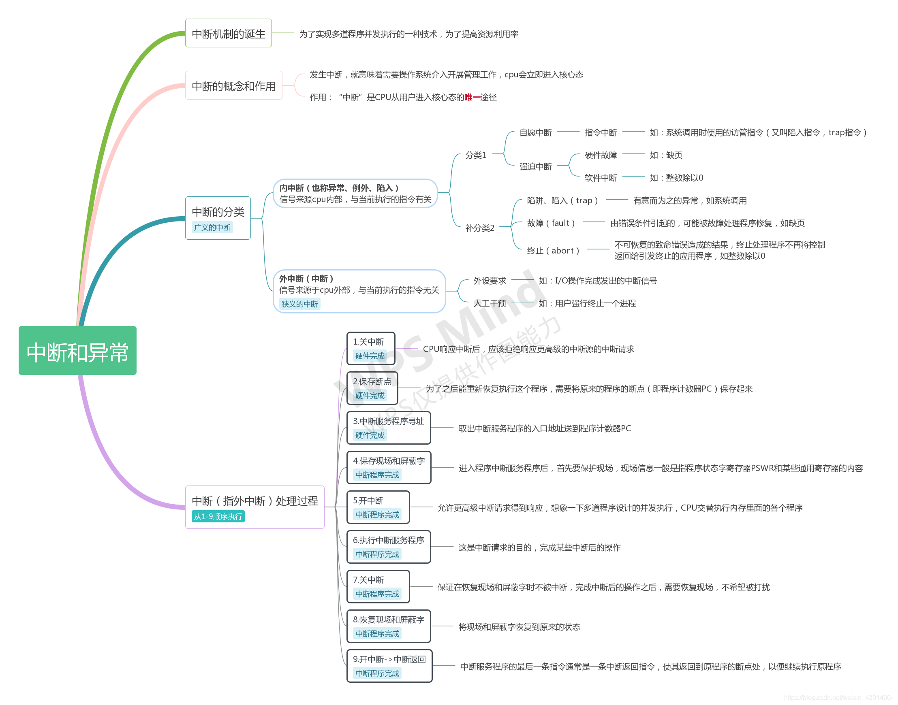

## 1.3.2 中断和异常（内中断和外中断、中断处理过程）

最新推荐文章于 2026-05-06 18:38:57 发布

原创 于 2020-02-23 16:58:55 发布 · 3.4w 阅读

· 88

· 69 · 本内容遵循CC 4.0 BY-SA版权协议

版权声明：本文为博主原创文章，遵循 [CC 4.0 BY-SA](http://creativecommons.org/licenses/by-sa/4.0/) 版权协议，转载请附上原文出处链接和本声明。

收录于

操作系统

当前文章被收录于：

[

操作系统

](https://blog.csdn.net/weixin_43914604/category_9734257.html "操作系统")

*62* 篇文章 *1144* 人学习

对操作系统的主要知识点进行梳理和图文结合的总结

订阅专栏 [查看详情](https://blog.csdn.net/weixin_43914604/category_9734257.html)

2048 AI社区

当前文章被收录于：

2048 AI社区

文章已被社区收录

博客涉及后端开发和操作系统领域，但具体内容缺失。后端开发涵盖多种编程语言和框架，操作系统有不同类型。这些信息技术领域对软件系统的运行和开发至关重要。

标签

[#后端](https://so.csdn.net/so/search/s.do?q=%E5%90%8E%E7%AB%AF&t=all&o=vip&s=&l=&f=&viparticle=&from_tracking_code=tag_word&from_code=app_blog_art) [#操作系统](https://so.csdn.net/so/search/s.do?q=%E6%93%8D%E4%BD%9C%E7%B3%BB%E7%BB%9F&t=all&o=vip&s=&l=&f=&viparticle=&from_tracking_code=tag_word&from_code=app_blog_art)

- 88
	点赞
- 踩
- 69
	收藏
	觉得还不错? 一键收藏
- 10
	评论
- 分享
- 举报
	举报

专栏目录

<iframe src="https://kunpeng-sc.csdnimg.cn/?timestamp=1645783940/#/preview1/4459498?positionId=58&amp;adBlockFlag=0&amp;adId=1109948&amp;queryWord=1.3.2%20%E4%B8%AD%E6%96%AD%E5%92%8C%E5%BC%82%E5%B8%B8%EF%BC%88%E5%86%85%E4%B8%AD%E6%96%AD%E5%92%8C%E5%A4%96%E4%B8%AD%E6%96%AD%E3%80%81%E4%B8%AD%E6%96%AD%E5%A4%84%E7%90%86%E8%BF%87%E7%A8%8B%EF%BC%89&amp;spm=1001.2101.3001.5002&amp;articleId=104462974" frameborder="0" width="100%" height="75px"></iframe>[DOS *中断* / BIOS *中断*](https://blog.csdn.net/qq_43450715/article/details/118974923)[qq\_43450715的博客](https://blog.csdn.net/qq_43450715)

07-21 4160[提示：文章写完后，目录可以自动生成，如何生成可参考右边的帮助文档 文章目录 前言 一、pandas是什么？ 二、使用步骤 *1**.*引入库 *2**.*读入数据 总结 前言 *中断* 是指计算机运行 *过程* 中，出现某些意外情况需主机干预时，机器能自动停止正在运行的程序并转入 *处理* 新情况的程序， *处理* 完毕后又返回原被暂停的程序继续运行。 提示：以下是本篇文章正文内容，下面案例可供参考 一、 *中断* 简介 执行完当前指令后，检测到从CPU内部或者外部发送过来的 *中断* 信息，并且可以立即对所接*.**.**.*](https://blog.csdn.net/qq_43450715/article/details/118974923)

10 条评论

[超级帅的陈星宇](https://blog.csdn.net/qq_59524897) 热评

除0属于故障吧？

写评论[*中断* ： *异常* vs *外中断*](https://blog.csdn.net/Edward1027/article/details/131814769)[Edward2022的博客](https://blog.csdn.net/Edward1027)

07-19 2358[*中断* ： *中断* 与 *异常*](https://blog.csdn.net/Edward1027/article/details/131814769)[*外中断* （ *中断* ）、 *内中断* （ *异常* ）](https://aerobaticswu.blog.csdn.net/article/details/125023667)[一个搬运知识的笨小孩](https://blog.csdn.net/weixin_48524215)

05-29 8466[*1**.**中断* 为什么需要 *中断* ？ 假设CPU正在跑一个程序 如果没有 *中断* ，那么CPU只能一直跑这个程序 如果有 *中断* ，给CPU一个 *中断* 信号，之后就可以让CPU跑其他程序了 *中断* *响应* *过程* 下图来自：OS学习笔记一： *中断* 与 *异常* 如何找到 *中断* 信号对应 *中断* 程序？ 使用 *中断* 向量表来找到 *中断* 信号对应的 *中断* 程序 *中断* 程序的作用是：对外部事件发出的 *中断* 请求及时地进行 *处理* ， *处理* 完成后又立即返回断点，继续进行CPU原来的工作（引用自： *中断* 的作用） *1**.**1* *外中断* *外中断* 与当前执行指令无关， *中断* 信号来源于CPU外部 当某种](https://aerobaticswu.blog.csdn.net/article/details/125023667)[【毕设实战】基于YOLOv8的HRSC *2* 0 *1* 6船舶智能检测系统开发全指南（含可视化UI界面，打造海事领域高分毕设）](https://blog.csdn.net/know_f0727/article/details/154755396)[know\_F0727的博客](https://blog.csdn.net/know_F0727)

11-12 101[亲爱的同学，通过这篇教程，你已经掌握了“基于YOLOv8的HRSC *2* 0 *1* 6微小船只检测系统”从数据集 *处理* 、模型训练到Tkinter界面开发的全流程。这个课题既贴合“海事智能化”的产业战略，又涵盖了“目标检测、深度学习、界面开发”等多个毕设评分点，非常适合作为计算机或海事工程专业的毕业设计。在实践中，你可能会遇到“海面背景复杂导致船只漏检”“微小船只识别精度不足”“UI与模型推理同步卡顿”等挑战——别担心，这些都是技术成长的必经之路。](https://blog.csdn.net/know_f0727/article/details/154755396)[*内中断* ， *外中断* ，软 *中断* ，硬 *中断* ， *异常* ，陷阱](https://devpress.csdn.net/v1/article/detail/123263326)

[

热门推荐

](https://devpress.csdn.net/v1/article/detail/123263326)

[qq\_40010871的博客](https://blog.csdn.net/qq_40010871)

03-04 2万+[不管是 *内中断* ， *外中断* ，软 *中断* 还是硬 *中断* 都是按照 *中断* 源来划分的。 一、 *外中断* 狭义上的 *中断* （interruption）指的就是 *外中断* 。 指来自CPU执行指令以外的事件的发生，希望 *处理* 机能够向设备发下一个输入/输出请求,同时让完成输入/输出后的程序继续运行。 简单来讲，就是外设请求或人为干预等当前执行指令之外的因素所引起的 *中断* 。 二、 *内中断* *内中断* 也常称作 *异常* （exception），指的是CPU执行当前指令时所发生的 *中断* ，一般分为两种： *1**.*自愿 *中断* 。比如当前执行的是trap指令。 *2**.*强迫 *中断* 。即当前指令在执](https://devpress.csdn.net/v1/article/detail/123263326)[《汇编语言》第十二章- *内中断*](https://blog.csdn.net/qq_43098197/article/details/125331555)[XiaoLing 一直摆烂哇！](https://blog.csdn.net/qq_43098197)

06-17 653[任意 CPU 在执行完当前正在执行的指令后，会检测到从 CPU 外部发送过来的或内部产生的一种特殊信息，并且可以立即对所接受到的信息进行 *处理* ，这种特殊的信息称为 *中断* 信息。 *中断* 的含义：CPU 不再继续往下执行，而是转去 *处理* 这个特殊信息。当 CPU 内部发生下列情况时，将会产生 *中断* 信息：不同的情况需要不同的 *处理* ，因此 CPU 所接收到的 *中断* 信息中必须包含识别来源的编码。8086CPU 用称为 *中断* 类型码的数据来标识 *中断* 信息的来源。 *中断* 类型码为一个字节型数据，可以表示 *2* 56 种 *中断* 信息的来源。产生 *中断* 信息的事件，](https://blog.csdn.net/qq_43098197/article/details/125331555)[【 *操作系统* *中断* ： *内中断* *和* *外中断* 】](https://blog.csdn.net/qq_66726657/article/details/135581642)[武帝为此的博客](https://blog.csdn.net/qq_66726657)

01-14 2109[*中断* 是一种计算机系统的事件，它打破了正常的程序执行流程，引起了 *操作系统* 的 *响应* 。 *中断* 可以由硬件或软件引发，它们用于 *处理* 异步事件，如外部设备的输入/输出、时钟信号、错误条件等。 *中断* 的存在使得 *操作系统* 能够实时 *响应* 各种事件，而不必等待某个任务的完成。](https://blog.csdn.net/qq_66726657/article/details/135581642)[【王道 *操作系统* 】 *1**.**3**.**2* *中断* *和* *异常* *(**内中断* *和* *外中断* 、 *中断处理* *过程**)*](https://blog.csdn.net/qq_29678157/article/details/128505493)[修行的凡人的博客](https://blog.csdn.net/qq_29678157)

12-31 400[基于《王道 *操作系统* 》得出的理论知识精华](https://blog.csdn.net/qq_29678157/article/details/128505493)[*中断处理* 的详细 *过程*](https://blog.csdn.net/weixin_44390164/article/details/119277787)[weixin\_44390164的博客](https://blog.csdn.net/weixin_44390164)

07-31 3526[*1**.* *中断* 请求阶段 *内中断* ：因为CPU内部出错导致的 *中断* 。不需要 *中断* 请求 外部 *中断* 会发生 *中断* 请求。 *2**.* *中断* 判优阶段 根据优先级选择优先级高的 *中断* 请求继续 *响应* *3**.* *中断* *响应* 阶段 经过 *中断* 判优， *中断处理* 进入 *中断* *响应* 阶段， *中断* *响应* 时，CPU向 *中断* 源发出 *中断* *响应* 信号，同时： 保护硬件现场 关 *中断* 保存断点 获得 *中断* 服务程序的入口地址 4*.* *中断* 服务阶段 保护现场 开 *中断* ：即允许 *中断* 服务程序运行时能有更高级别的 *中断* 请求出现，实现 *中断* 嵌套 *中断* 服务 恢复现场：恢复主程序的 *中断* 线程，通常是将](https://blog.csdn.net/weixin_44390164/article/details/119277787)[计算机组成原理—— *内中断* 与 *外中断*](https://devpress.csdn.net/v1/article/detail/149502544)[gis\_csdn的博客](https://blog.csdn.net/gis_csdn)

07-21 1914[摘要： 计算机系统中的 *中断* 分为 *内中断* （ *异常* ） *和* *外中断* （硬件 *中断* ）。 *内中断* 由CPU内部指令触发（如缺页、除零错误），同步且不可屏蔽； *外中断* 由外部设备发起（如键盘、网卡），异步且多数可屏蔽。关键区别在于触发源（CPU内部 vs 外部设备）、同步性及可屏蔽性。 *内中断* 需立即 *处理* 错误或终止程序， *外中断* 由驱动 *响应* 设备请求。系统调用属于 *内中断* （陷阱），NMI（不可屏蔽 *中断* ） *处理* 硬件致命错误。理解二者差异对 *操作系统* 开发（ *异常* *处理* 、驱动编写） *和* 调试至关重要。](https://devpress.csdn.net/v1/article/detail/149502544)[*操作系统* 中的 *中断*](https://blog.csdn.net/ypshowm/article/details/89174951)[ypshowm的博客](https://blog.csdn.net/ypshowm)

04-10 1万+[*中断* 是指CPU对系统发生的某个事件做出的一种反应，CPU暂停正在执行的程序，保存现场后自动去执行相应的 *处理* 程序， *处理* 完该事件后再返回 *中断* 处继续执行原来的程序。。 *中断* 一般三类，一种是由CPU外部引起的，称为 *外中断* 。如I/O *中断* 、时钟 *中断* ，一种是来自CPU内部事件或程序执行中引起的 *中断* ，例如程序非法操作，地址越界、浮点溢出）称为 *内中断* ，或者（ *异常* ，陷入），最后一种是在程序中使用了系统调用引起的。而 *中断**.**.**.*](https://blog.csdn.net/ypshowm/article/details/89174951)[*中断处理* *过程* 示意图\_ *中断* *和* *中断处理* 流程](https://blog.csdn.net/weixin_39540725/article/details/111555219)[weixin\_39540725的博客](https://blog.csdn.net/weixin_39540725)

12-20 5286[*1**.* *中断* 概念 *中断* 是指由于接收到来自外围硬件 *(*相对于中央 *处理* 器 *和* 内存*)* 的异步信号或来自软件的同步信号，而进行相应的硬件／软件 *处理* 。发出这样的信号称为进行 *中断* 请求 *(*interrupt request，IRQ*)* 。硬件 *中断* 导致 *处理* 器通过一个上下文切换 *(*context switch*)* 来保存执行状态 *(*以程序计数器 *和* 程序状态字等寄存器信息为主*)* ；软件 *中断* 则通常作为CPU指令集中的一个指令，以可编程的方式直接指*.**.**.*](https://blog.csdn.net/weixin_39540725/article/details/111555219)[*中断* *和* *中断处理* 流程](https://blog.csdn.net/feelinghappy/article/details/108087995)[feelinghappy的专栏](https://blog.csdn.net/feelinghappy)

08-18 3733[*1**.* *中断* 概念 *中断* 是指由于接收到来自外围硬件（相对于中央 *处理* 器 *和* 内存）的异步信号或来自软件的同步信号，而进行相应的硬件／软件 *处理* 。发出这样的信号称为进行 *中断* 请求（interrupt request，IRQ）。硬件 *中断* 导致 *处理* 器通过一个上下文切换（context switch）来保存执行状态（以程序计数器 *和* 程序状态字等寄存器信息为主）；软件 *中断* 则通常作为CPU指令集中的一个指令，以可编程的方式直接指示这种上下文切换，并将 *处理* 导向一段 *中断处理* 代码。 *中断* 在计算机多任务 *处理* ，尤其是实时系统中尤为有用。这样的系统](https://blog.csdn.net/feelinghappy/article/details/108087995)[*中断* 系统详解： *中断* 分类、 *中断处理* 流程、 *中断* 向量表](https://blog.csdn.net/2301_78967994/article/details/153684982)[比较是偷走幸福的小偷](https://blog.csdn.net/2301_78967994)

10-26 3178[*中断* 系统是 *操作系统* *响应* 外部事件的核心机制。为什么键盘按键能立即 *响应* ？ *中断* *和* 轮询有什么区别？ *中断处理* 流程是怎样的？ *中断* 向量表的作用是什么？理解 *中断* 的分类、 *中断* *响应* *过程* 、 *中断* 优先级、 *中断* 嵌套机制，才能掌握 *操作系统* 事件 *处理* 的本质。从"键盘按键秒 *响应* "现象出发，剖析 *中断* 系统的核心原理。通过 *外中断* 与 *内中断* 的分类、 *中断* *响应* 的完整流程、 *中断* 向量表的索引机制、 *中断* 优先级与屏蔽的策略，揭秘 *操作系统* 事件驱动的完整逻辑。配合详细时序分析，给出 *中断处理* 的透彻理解。南北绿豆 *中断* ：CPU *响应* 外部事件的机制 *外中断* 。](https://blog.csdn.net/2301_78967994/article/details/153684982)[CHS\_0 *2**.**1**.**3**.**2* + *中断* *和* *异常*](https://blog.csdn.net/qq_46118239/article/details/135483498)[qq\_46118239的博客](https://blog.csdn.net/qq_46118239)

01-09 865[在这个小节中 我们会学习 *中断* *和* *异常* 相关的知识点 那首先我们会介绍 *中断* 的作用 这其实在上小节当中也有提到过只不过由于这个内容十分重要 所以还是愿意做一个复读机 另外 我们会介绍一下。](https://blog.csdn.net/qq_46118239/article/details/135483498)[*中断处理* *过程*](https://blog.csdn.net/qq_40742428/article/details/99443019)[Hello World](https://blog.csdn.net/qq_40742428)

08-13 2万+[概念 *中断* 全 *过程* 指的是从 *中断* 源发出 *中断* 请求开始，CPU *响应* 这个请求，现行程序被 *中断* ，转至 *中断* 服务程序，直到 *中断* 服务程序执行完毕，CPU再返回原来的程序继续执行的整个 *过程* 。 执行 *过程* 大体上可以把 *中断* 全 *过程* 分为5个阶段： *中断* 请求、 *中断* 判优、 *中断* *响应* 、 *中断处理* *和* *中断* 返回。 *.**.**.*](https://blog.csdn.net/qq_40742428/article/details/99443019)[PC\_OS *中断* / *中断* 屏蔽字](https://cxxu1375.blog.csdn.net/article/details/127897102)[xuchaoxin1375的博客](https://blog.csdn.net/xuchaoxin1375)

11-17 5865[由于许多 *中断* 源提出 *中断* 请求的时间都是随机的，因此当多个 *中断* 源同时提出请求时，需通过 *中断* 判优逻辑确定 *响应* 哪个 *中断* 源的请求，当 *处理* 机正在 *处理* 一个 *中断* 时，将屏蔽掉所有的 *中断* ，即 *处理* 机对任何新到的 *中断* 请求，都暂时不予理睬，而让它们等待。直到 *处理* 机已完成本次 *中断* 的 *处理* 后， *处理* 机再去检查是否有 *中断* 发生。CPU暂停正在执行的程序，保留CPU环境后，自动地转去。与 *(*外*)* *中断* 一样，若系统发现了有陷入事件，CPU也将。若有，再去 *处理* 新到的 *中断* ，若无，则返回被 *中断* 的程序。执行完后，再回到断点，继续执行原来的程序。](https://cxxu1375.blog.csdn.net/article/details/127897102)[【 *2* 0 *2* 6OD新机考】【哈希表】 *2* 0 *2* 604 *2* *2* -文章特征提取【Py/Java/C++/C/JS/Go六种语言OD真题】【欧弟算法】全网注释最详细分类最全的华子OD真题题解](https://blog.csdn.net/weixin_48157259/article/details/160830246)

[

最新发布

](https://blog.csdn.net/weixin_48157259/article/details/160830246)

[weixin\_48157259的博客](https://blog.csdn.net/weixin_48157259)

05-06 45[90+天陪伴式学习， *1* 00+直播课时， *3* 00+动画图解视频，500+LeetCode经典题，500+华为OD真题/大厂真题，还有简历修改、模拟面试、陪伴小群、资深HR对接将为你解锁。这道题的本质是多集合交集问题的变形，属于非常典型的哈希表应用题。，储存全局的每个片段中，各个字符最少出现的次数。表示该字母并非所有片段的公共字母。，按照顺序构建答案即可。没有字母在所有三个字符串中都出现。每个字母在各字符串中都至少出现。次，所以结果中每个字母出现一次。这样，当上述循环结束后，最终。显然在上述代码中，如果字母。](https://blog.csdn.net/weixin_48157259/article/details/160830246)[理光MP *2* 0 *1* 4MP *2* 0 *1* 4AD维修手册维修代码*.*pdf](https://download.csdn.net/download/hnhening/12797526)[理光数码复印机MP *2* 0 *1* 4，MP *2* 0 *1* 4D，MP *2* 0 *1* 4AD维修手册维修代码，维修人员专用手册，维修调试代码手册](https://download.csdn.net/download/hnhening/12797526)- [关于我们](https://www.csdn.net/company/index.html#about)
- [招贤纳士](https://www.csdn.net/company/index.html#recruit)
- [商务合作](https://fsc-p05.txscrm.com/T8PN8SFII7W)
- [寻求报道](https://marketing.csdn.net/questions/Q2202181748074189855)
- [协议专区](https://marketing.csdn.net/p/a65bad49d09e5e6d1a9c674bb41ef331?pId=3340)
- 400-660-0108
- [kefu@csdn.net](mailto:webmaster@csdn.net)
- [在线客服](https://csdn.s2.udesk.cn/im_client/?web_plugin_id=29181)
- 工作时间 8:30-22:00
- [公安备案号11010502030143](http://www.beian.gov.cn/portal/registerSystemInfo?recordcode=11010502030143)
- [京ICP备19004658号](http://beian.miit.gov.cn/publish/query/indexFirst.action)
- [京网文〔2020〕1039-165号](https://csdnimg.cn/release/live_fe/culture_license.png)
- [经营性网站备案信息](https://csdnimg.cn/cdn/content-toolbar/csdn-ICP.png)
- [北京互联网违法和不良信息举报中心](http://www.bjjubao.org/)
- [家长监护](https://download.csdn.net/tutelage/home)
- [网络110报警服务](https://cyberpolice.mps.gov.cn/)
- [中国互联网举报中心](http://www.12377.cn/)
- [Chrome商店下载](https://chrome.google.com/webstore/detail/csdn%E5%BC%80%E5%8F%91%E8%80%85%E5%8A%A9%E6%89%8B/kfkdboecolemdjodhmhmcibjocfopejo?hl=zh-CN)
- [账号管理规范](https://blog.csdn.net/blogdevteam/article/details/126135357)
- [版权与免责声明](https://www.csdn.net/company/index.html#statement)
- [版权申诉](https://blog.csdn.net/blogdevteam/article/details/90369522)
- [出版物许可证](https://img-home.csdnimg.cn/images/20250103023206.png)
- [营业执照](https://img-home.csdnimg.cn/images/20250103023201.png)
- ©1999-2026北京创新乐知网络技术有限公司