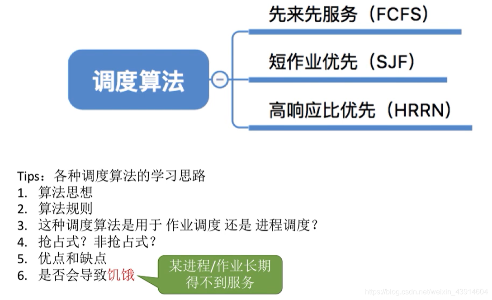
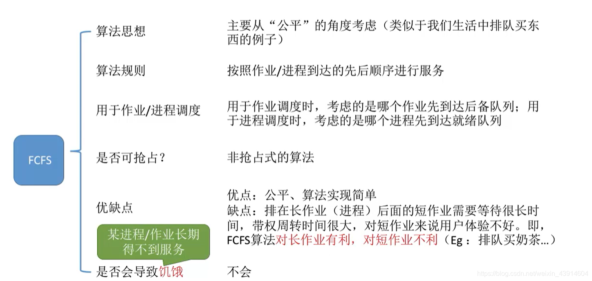
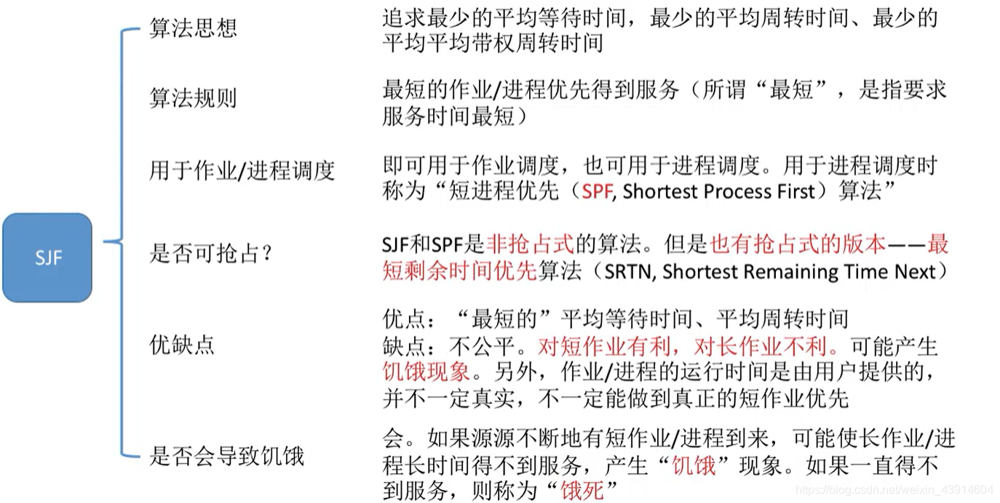
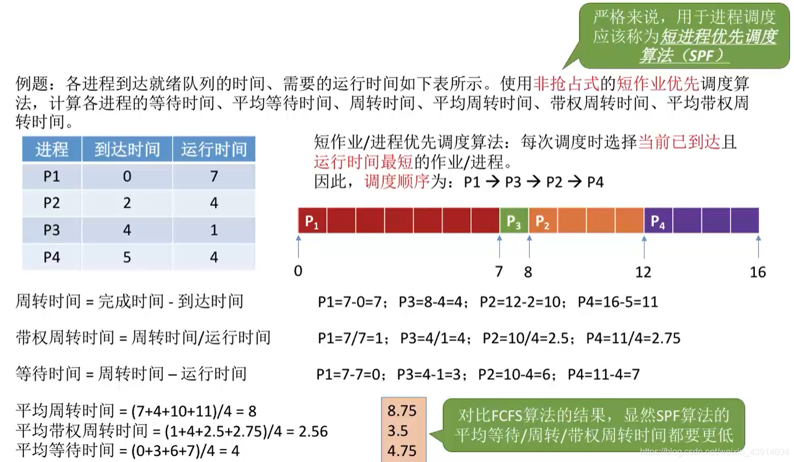
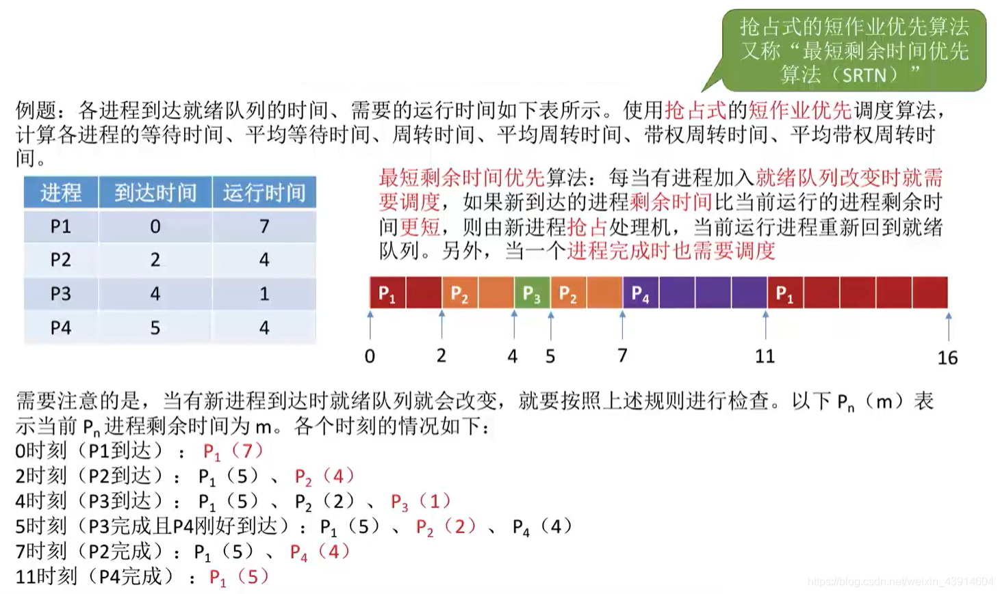
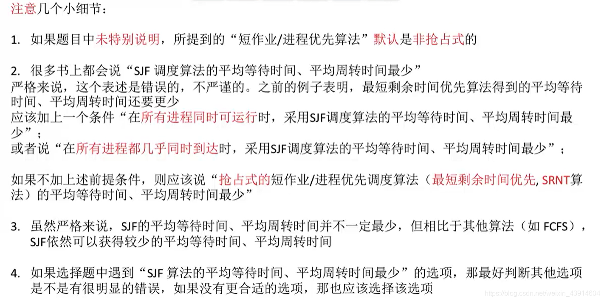
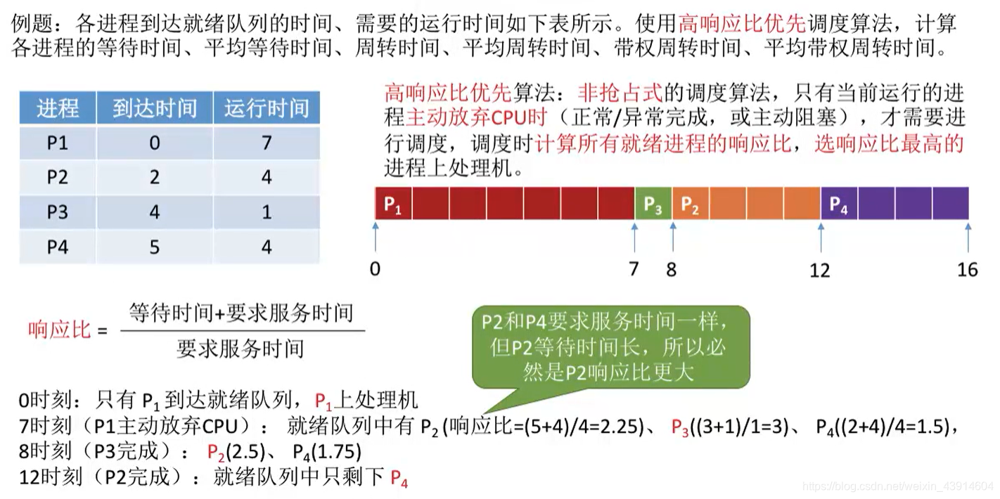

---

##### 0.思维导图

##### 1.先来先服务—FCFS

- First come first sever  
	

##### 2.短作业优先—SJF

- Shortest Job First

- 非抢占式—SJF  
	
- 抢占式—SJF(SRTN)  
	
- 注意几个细节  
	

##### 3.高响应比优先—HRRN

- Highest Response Ratio Next

  

